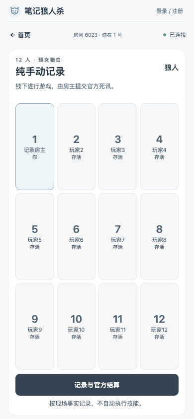
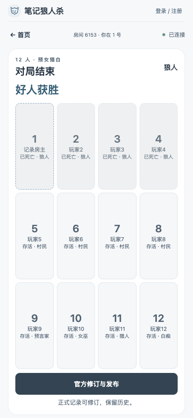
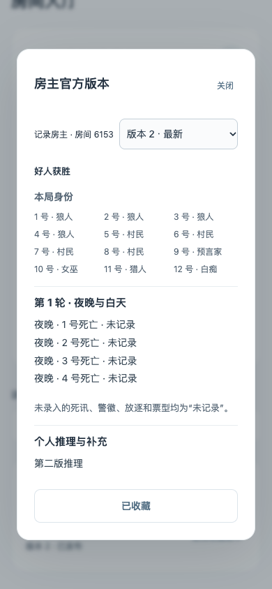

# 手动记录与版本收藏测试报告

日期：2026-10-10。验收基线为详细需求 V1 的手动记录与复盘章节，以及当前用户明确确认。原有自动对局、准备、账号与暂停功能继续保留。所有以下浏览器测试均为本机 Chrome 自动化，不代表真实 iPhone 或多台手机验收。

## 已实现

- 准备配置可直接开始纯手动；房主也可二次确认从自动单向切换，停止自动计时和技能。已公开死讯、警徽以及已锁定身份保留，未公告死讯和秘密死因不提前导入。
- 每个参赛房主 / 有效 VIP 独立私密草稿：死亡座位、轮次、夜 / 昼、可选死因，警徽、放逐、个人票型、个人推理。保存校验修订号，旧请求不得覆盖新记录；关闭未保存编辑时可保存 / 放弃 / 返回。
- 房主提交官方死亡记录后服务器按当前 12 人预女猎白计算屠边胜负。VIP 可申请结束；只共享事实，不共享个人推理；房主审阅后采纳 / 拒绝，采纳保留房主自己的推理，个人版本不被覆盖。没有批准不自动结束。
- 结束后官方可修正并保留每次提交。完整官方修订仅房主读取；其他参局玩家只读取作者主动发布的版本。修正后无胜负仍保持结束状态，显示“未达成胜负”，不偷偷恢复引擎。
- 主动发布产生不可变历史，草稿编辑不影响已发布内容。收藏关联帖子并跟随主动发布的最新版本，撤回后入口保留而正文 / 历史不可读；再发布恢复。原有自动记录收藏仍保留原始快照。
- 记录、发布历史、参赛访问名单与收藏独立归档；账号关联、进程重启、活动房间删除后继续可用。后台只读已结束已发布记录，无法读取草稿或绕过撤回。
- 管理员可开通永久 / 限时 VIP 或取消，服务器实时校验。到期后本人仍可读草稿和撤回，不能编辑、发布或申请结束。此交付不包含支付与对外分享。
- 同账号新登录原子撤销旧会话并断开旧实时连接。旧 HTTP 身份 / 技能 / 私密记录请求及旧 socket 重连无权访问；原玩家、座位、身份、阶段、倒计时保持。密码错误与身份冲突不影响原授权。

## 实际测试结果

| 验证 | 实际结果 | 证据范围 |
|---|---|---|
| `npm test` | 134 通过，0 失败 / 跳过 | 全套领域、SQLite、HTTP、Socket.IO 及权限回归 |
| `npm run build` | 通过 | TypeScript 检查与 Vite 生产构建；有依赖注释警告，无构建失败 |
| 完整 Playwright | 23 通过 | 原有 20 项与新增 3 项手动记录浏览器流程，隔离 3100 端口 / 内存数据库 |
| 手机尺寸 | 320×568、390×844、430×932 通过 | 主屏无页面滚动，主按钮及底部提示边界在视口内；等待浏览器重绘后截图 |
| `git diff --check` | 通过 | 工作树无空白格式错误 |
| 本地与 LAN 健康检查 | 两处均返回 `status: ok` | localhost:3000 和 10.0.0.91:3000；不是实际手机访问证据 |

新增浏览器流程每局创建 12 个独立 cookie 上下文，使用原有 API 完成准备与实体身份锁定；房主、VIP 和普通玩家使用不同页面验证实时状态。这些是模拟独立客户端，未使用同一身份的两个标签冒充不同玩家。

1. 房主保存私密草稿后普通玩家公共死讯仍为空；提交官方记录才统一更新并结束。普通玩家没有草稿保存权限，但可读主动发布的赛后全部身份与版本。
2. 收藏初版后作者编辑草稿不改变正文；发布第二版后收藏跟随，历史初版仍可选择。撤回后历史 HTTP 拒绝读取、首页入口标记撤回；再发布恢复原帖子。修改官方死讯、提交修订后保持结束状态，刷新不重复记录。
3. 暂停中的自动夜晚切换纯手动：取消确认不切换，确认后显示手动主屏，旧夜间操作返回 409，刷新后不恢复原暂停倒计时。
4. VIP 与房主草稿 ID 不同；VIP 结束申请只向房主共享事实，普通玩家只看到待确认。房主拒绝后继续，再申请并采纳才结束；双方推理保持各自内容，赛后发布两份独立版本。

后端额外覆盖：严格输入拒绝伪造身份 / 作者与重复死亡、并发 / 过期修订、未发布推理不进入广播或完整修订旁路、未参赛访客拒绝、VIP 到期 / 撤销、公开导入隐藏死因、原警徽转移 / 撕徽事件、重复提交 / 发布不重复建版本、登录迁移与冲突回滚、归档后官方修订 HTTP 成功、管理员的发布 / 撤回访问边界。

## 审查与修复

独立只读审查发现并修复：完整官方修订历史曾可能让参局用户读到未发布推理；归档后修订发布成功却可能返回房间不存在；警徽导入曾未匹配实际 `transfer_badge` 事件。针对这些问题先复现失败，再补修复和通过测试。随后窄范围复查未发现记录迁移、VIP 推理隔离或管理员记录访问的新缺陷。审查者的部分 HTTP 测试被其环境端口权限阻止；主执行环境的全套 HTTP / Socket 与浏览器测试已实际通过。

## 数据库与本地服务

升级前已通过 SQLite backup API 备份到 `.data/lobby.before-records-20261010-1791660814194.db`。对该备份的临时克隆运行迁移至 schema 12，校验原 6 房间 / 50 成员，以及 members、identities、night_games、day_games 四张表的 SHA-256 指纹均未变化。新增记录表及 VIP 表不重发牌、不重建座位。已运行中的旧纯手动房间会补建手动状态，不改变角色和座位。

当前开发服务已重新加载后端并监听 0.0.0.0:3000，测试玩家开关开启。电脑刷新 `http://localhost:3000`，手机同 Wi-Fi 访问 `http://10.0.0.91:3000`。IP 改变时用 `ipconfig getifaddr en0` 查询。数据库与初始管理员凭证均不提交 Git。

## 体验路径

- 新房间：入座 → 房主选择纯手动记录与发牌方式 → 准备 / 发牌 / 确认 → 记录与官方结算。
- 自动游戏：导航“记录” → 房主“切换纯手动记录” → 再次确认。结束后“官方修订与发布”；参局玩家“查看复盘版本”。
- 已发布版本：查看 → 收藏此版本帖子 → 首页我的收藏。历史下拉可查看旧发布版本。
- VIP：现有管理员登录后台，用户条目开通永久或到期 VIP；有效 VIP 参赛者可打开自己的独立记录。

主屏、赛后与历史截图：

## 未验证与下一阶段

- 未进行真实 iPhone Safari、多台实体手机、锁屏后台恢复或公网 HTTPS 验收。手机截图是 Chrome 视口模拟；未验证真实 Safari 键盘和动态工具栏下的编辑弹窗体验。
- M-01 手动切回自动未决，没有入口；H-01 房主失联的结束申请保持待确认；H-02 死因只记录事实，不据此重演吞毒、猎人技能、遗言或扩展板子状态。这些问题仍在 OPEN_QUESTIONS.md。
- 下一阶段先验收真实手机联机、公共语音及已有规则边界，再推进支付、对外分享、评论、通知及完整后台。14 人和扩展角色规则继续等待单独确认。
